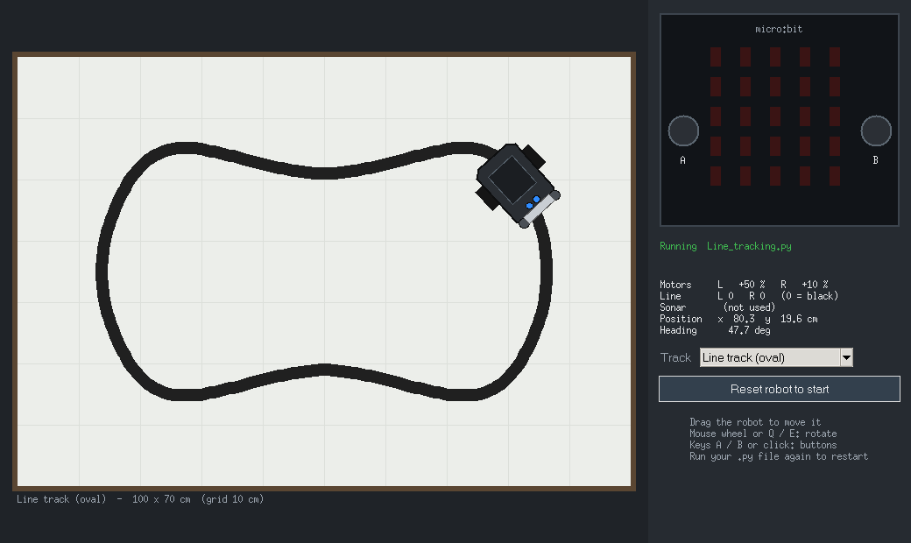

# Cutebot Simulator for PyCharm (LSBU)

Run micro:bit MicroPython programs for the Elecfreaks **Cutebot** on a PC, inside
PyCharm, with no hardware. The same file can then be flashed to the real robot
unchanged.

It was written for the LSBU MicroPython labs
(https://github.com/LSBU-Electronics-Lab/MicroPython/wiki). Labs 1-9 run
unmodified.



## What is simulated

| Hardware | How your code uses it | Simulated |
|---|---|---|
| 5x5 LED display | `display.show / scroll / set_pixel`, `Image` | yes, with the real micro:bit font and built-in images |
| Buttons A and B | `button_a.is_pressed()`, `was_pressed()`, `get_presses()` | click them or press the **A** / **B** keys |
| Motors | `i2c.write(0x10, [0x01 or 0x02, dir, speed, 0])` | yes (Elecfreaks mapping: **0x01 = left, 0x02 = right**; dir 0x02 = forward, 0x01 = backward) |
| Headlights | `i2c.write(0x10, [0x04 or 0x08, R, G, B])` | yes |
| Line sensors | `pin13` (left), `pin14` (right) `.read_digital()` | yes: **0 over the black line, 1 over white** |
| Ultrasonic sensor | trigger `pin8`, echo `pin12`, or `machine.time_pulse_us` | yes, against walls and obstacles |
| NeoPixels | `neopixel.NeoPixel(pin15, 2)` | yes (shown as underglow) |
| Timing | `sleep`, `running_time`, `utime.*`, `time.*` | yes, real time |
| Accelerometer, compass, sound, radio | | placeholders only (not simulated yet) |

## Setup (once per PC)

1. Install Python 3.9 or newer from python.org. Keep the default **tcl/tk and IDLE**
   option ticked, because the simulator window uses Tkinter. Nothing else needs
   installing: the simulator only uses the Python standard library.
2. In PyCharm: **File > Open...** and choose this `CutebotSim` folder.
3. When PyCharm asks for an interpreter, create a virtual environment (any
   Python 3.9+ works).
4. **Run `install_simulator.py` once** (right-click it > Run). This lets
   `from microbit import *` work from any folder. Run it again if you make a
   new virtual environment.

Put your own programs in the `labs` folder (right-click `labs` > New > Python File).

## Running a program in the simulator

1. Open a file, e.g. `examples/03_line_follow.py`.
2. Right-click in the editor, then **Run '03_line_follow'** (the normal green
   Run button).
3. The simulator window opens. Choose the track in the **Track** box.

Notes:
* Your own lab files go in `labs/`. If you get
  `ModuleNotFoundError: No module named 'microbit'`, you have not run
  `install_simulator.py` with this interpreter yet.
* **Do not install `microbit`, `microbit-stubs`, `microbit-dummy` (or similar) with
  pip / PyCharm's package manager.** They contain empty look-alike `microbit`,
  `machine` and `neopixel` modules; programs would then run without doing anything.
  `install_simulator.py` makes the simulator take priority anyway and warns if one
  is installed. PyCharm's code completion already works from the simulator itself.
* Do not name your own files `microbit.py`, `utime.py`, `machine.py` or
  `neopixel.py`: they would hide the simulator's modules.
* The window stays open between runs. Running again is like re-flashing the
  micro:bit: the new program takes over and the robot goes back to its start
  position.
* Drag the robot with the mouse to place it. Rotate it with the mouse wheel or
  the Q / E keys. The next run starts from where you put it. **Reset robot to
  start** goes back to the track's start.
* **Debugging works.** Set a breakpoint and use **Debug** instead of Run. The
  robot freezes while your code is paused, so you can inspect the sensor values.
* As on the real robot, if your program ends while the motors are on, the
  Cutebot keeps moving. Press **Stop** or close the window to end it.
* If the window does not appear, look at `cutebot_sim_window.log` in your temp
  folder.

## Building your own arena

All sizes and coordinates are in **centimetres**. The origin is the bottom-left
corner, x points right and y points up. Angles: 0 = facing right, 90 = facing up.
Hovering the mouse shows the coordinates under the cursor.

**Tools** (buttons above the arena, or keys 1-4):

| Tool | What it does |
|---|---|
| 1 Move | Drag the robot or an obstacle (obstacles snap to whole cm). Click empty floor to copy x, y into the Obstacles tab. |
| 2 Draw line | Drag to draw black tape freehand. Hold **Shift** for a straight line. Ends that finish near another line end join automatically, and a loop closes itself if you finish near the start. |
| 3 Erase | Drag over a line to rub it out (red circle). Click an obstacle to delete it. |
| 4 Draw obstacle | Drag out a rectangle. |

**Deleting an obstacle:** click it (it turns yellow) and press **Delete**, or click it with the Erase tool, or right-click it, or select it in the Obstacles tab and press **Delete selected**. Esc goes back to Move.

**Side tabs:**
* **Robot**: type an exact position and angle and press **Place robot**, or use
  the 0/90/180/270 buttons. **Set start here** makes the current pose the start
  position, so **Reset to start** goes there and it is saved with the layout.
* **Obstacles**: add an obstacle by its bottom-left corner and width x height,
  see the list (the selected one is outlined in yellow), remove one or all.
* **Arena**: set the arena width and height (30-500 cm) and the line width.
  Load a preset (oval, figure eight, obstacles, maze for Lab 10, empty), clear
  the lines, and **Save layout... / Open layout...** to keep and share layouts
  as `.json` files (examples are in `layouts/`).

Changes take effect immediately, even while a program is running. The current
arena is saved automatically in `sim_layout.json` and reopened next time.

## Motor mismatch (making the robot behave like a real one)

Real motors are never identical: with `motors(25, 25)` a real Cutebot usually
drifts to one side. The **Motors** tab simulates this without changing your code.

* Set **left %** and **right %** (100 = exact, 92 = 8 % weaker) and press **Apply**.
  The panel shows the speeds the wheels really get, e.g. "code 25 gives right 23.0".
* **Random hidden** gives one wheel a secret 3-15 % weakness: an exercise for
  students to find the correction. **Reveal** shows it. **Exact** removes it.
* The **path trail** (red) and the **straightness** read-out (forward distance,
  sideways drift, angle turned since the run started) show how straight it went.
* After a run at one constant speed, the read-out also suggests a **correction**,
  e.g. "right wheel is ~92 % of the other - try motors(25, 27) or motors(23, 25)".
  It is worked out only from what the robot did (distance and angle turned), not from
  the hidden setting, so it is the same calculation you can do with a real robot:
  wheel distances = forward distance +/- (angle in radians x wheel spacing / 2),
  and new speed = old speed x (distance of the faster wheel / distance of the slower wheel).
* Change the speeds in your code and run again until the drift is close to zero.
  Speeds are whole numbers, so a small drift can remain. Use the same numbers on the real robot.

The setting is saved with the arena and in layout files, so a teacher can hand out a
layout with a hidden mismatch.

**Speeds must be whole numbers (0-100).** The Cutebot receives each speed as one byte
over I2C, so `bytearray([0x01, 0x02, 25.5, 0])` raises `TypeError` on the micro:bit
(and in the simulator). Convert first, e.g. `int(round(25 * 1.08))`.

## Running the same program on the real Cutebot

Use the MicroPython plugin's **Flash** run configuration, exactly as in the wiki.
The board has its own built-in `microbit` module, so the files in this project
are not used there.

## Command line

```
python examples/03_line_follow.py          # run with the window
python -m cutebot_sim.gui                  # open the window on its own
python tests/smoke_test.py                 # self-check (no window)
python tests/check_line_follow.py examples/03_line_follow.py 30 0
```

## Robot size and calibration

The robot is 8.5 x 8.5 cm, like the real Cutebot. Its size is set by a few
measurements at the top of `cutebot_sim/robot.py` (overall length and width,
wheel size, axle position, line-sensor position and spacing). The drawing,
wheel spacing, sensors and collisions are all calculated from them, so to match
your robot exactly just measure it and change those numbers.
Top speed and motor response are approximations and can be tuned there too.

## Project layout

```
microbit/            the simulated micro:bit module (what students import)
utime.py machine.py neopixel.py music.py   other MicroPython modules
cutebot_sim/
    robot.py         Cutebot hardware model and physics
    maps.py          tracks (units: cm)
    display.py       Image and display
    runtime.py       starts/links to the window, runs the physics thread
    gui.py           the simulator window (Tkinter, separate process)
    shared.py        shared-memory link between program and window
    _data.py         micro:bit font and images (MIT, see file header)
examples/            example programs
tests/               self-checks
```

## How it works

Importing `microbit` starts a physics thread inside your program and connects to
the simulator window, which runs as a separate process. The two exchange the
robot's state through a small block of shared memory. Because the physics runs
inside your program, pausing at a breakpoint also pauses the robot. The window
only draws the robot and sends button presses and mouse actions back.

## Credits

micro:bit font: Lancaster University codal-core (MIT). Built-in images:
micropython-microbit-v2 by Damien P. George (MIT). Both are included in
`cutebot_sim/_data.py` with their notices.
