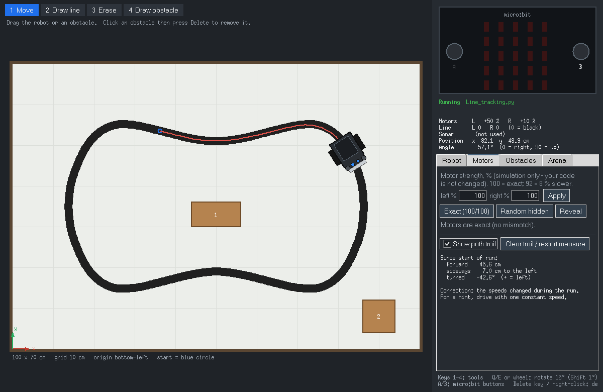
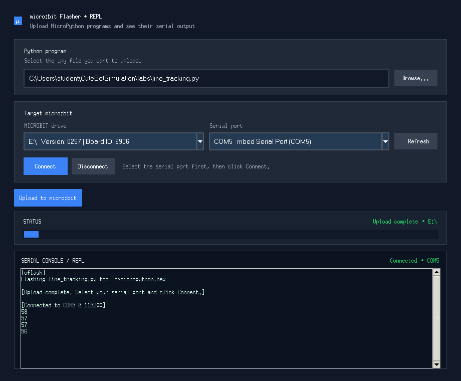

# Cutebot Simulator for PyCharm

Write micro:bit **MicroPython** for the Elecfreaks **Cutebot** in PyCharm, press **Run**,
and watch the robot drive in a simulator window: no hardware needed. The same file can
then be flashed to a real Cutebot **without any changes**.

Made for the [LSBU MicroPython labs](https://github.com/LSBU-Electronics-Lab/MicroPython/wiki)
(T411 Robotics Laboratory, London South Bank University). All complete programs from
Labs 1–9 run unmodified; Lab 10 has a ready-made maze.



## Features

- Real micro:bit API: `from microbit import *` works exactly as on the board
  (display, buttons, pins, I2C, `utime`, `machine`, `neopixel`, `music`).
- Simulated Cutebot: motors, headlights, line sensors, ultrasonic sensor, NeoPixels,
  at the real robot's size (8.5 × 8.5 cm).
- Sensors: tilt the micro:bit, shake it, clap at the microphone, hear music, set temperature and light.
- Arena editor: set the size in cm, 1 cm grid, draw and erase black lines, add, move and resize
  obstacles, measure distances, save and share layouts as `.json` files.
- Motor mismatch: make one wheel weaker, like a real robot, and get a suggested speed
  correction to drive straight.
- Code view: highlights the line your program is running and lists the last motor commands.
- Pause, step one line at a time, slow motion, and automatic pauses when the motors change, a
  line sensor changes or the robot bumps into something.
- Live graphs of the line sensors, ultrasonic distance and motor speeds.
- Code checker: finds things that work on the PC but fail on the micro:bit, before you upload.
- Realistic mode: sensor noise, missed sonar echoes and a motor dead zone, like the real robot.
- Radio: the real `radio` module, with a console to send and receive messages.
- Challenge mode: start, checkpoint and finish zones, a timer, bump penalties and best times.
- LAN competitions: a teacher's dashboard starts races for the whole class (time trial or
  one shared arena with radio between robots), with a live leaderboard.
- Debugging: breakpoints pause the robot too, so you can inspect sensor values.
- RESET button on the simulated micro:bit restarts your program, like the real one.
- Built-in micro:bit reference: search any function (e.g. `display`, `motor`, `sleep`) and
  open its page in the official V2 documentation.
- Real hardware: upload the same file to a Cutebot with the micro:bit Flasher + REPL tool.
- Standard library only: nothing to `pip install`.

## What is simulated

| Hardware | How your code uses it | Notes |
|---|---|---|
| 5×5 LED display | `display.show / scroll / set_pixel`, `Image` | real micro:bit font and built-in images |
| Buttons A and B | `button_a.is_pressed()`, `was_pressed()`, `get_presses()` | click them or press the **A** / **B** keys |
| Motors | `i2c.write(0x10, bytearray([0x01 or 0x02, dir, speed, 0]))` | Elecfreaks mapping: **0x01 = left, 0x02 = right**; dir 0x02 = forward, 0x01 = backward; speed 0–100 (whole numbers) |
| Headlights | `i2c.write(0x10, bytearray([0x04 or 0x08, R, G, B]))` | 0x04 = left, 0x08 = right |
| Line sensors | `pin13` (left), `pin14` (right) `.read_digital()` | **0 over the black line, 1 over white** |
| Ultrasonic sensor | trigger `pin8`, echo `pin12`, or `machine.time_pulse_us` | measures to walls, obstacles and other robots; no reading closer than 2 cm (like the real HC-SR04) |
| NeoPixels | `neopixel.NeoPixel(pin15, 2)` | shown as underglow |
| Timing | `sleep`, `running_time`, `utime.*`, `time.sleep_ms` … | real time at 1x; follows pause and slow/fast motion |
| Accelerometer | `accelerometer.get_x/y/z()`, `current_gesture()`, `was_gesture('shake')`, `set_range(2/4/8)` | **Upright on the Cutebot** (default, as on the robot): y ≈ −1024 at rest, speeding up, braking and crashes show in z (front/back) and x (sideways), the tilt pad tilts the robot. Untick it for a micro:bit on its own (flat). Try `examples/07_crash_detect.py`. |
| Microphone (V2) | `microphone.sound_level()`, `was_event(SoundEvent.LOUD)` | level slider and **Clap** button |
| Speaker / music | `music.play(...)`, `music.pitch(...)`, `audio.play(Sound.HAPPY)` | note shown on screen; real beeps on Windows if enabled |
| Compass | `compass.heading()` | the robot's heading (north = top of the arena) |
| Temperature, light | `temperature()`, `display.read_light_level()` | sliders |
| Radio | `import radio`, `radio.on()`, `config(group=…)`, `send`, `receive`, `send_bytes`, `receive_full` | **Radio** window to send/receive; reaches other robots in a LAN shared arena |
| Bluetooth | | not simulated (not available in MicroPython on the micro:bit either) |

## Quick start

### 1. Install Python, PyCharm and Git

| Software | Download | Notes |
|---|---|---|
| **Python 3.9+** (required) | [python.org/downloads](https://www.python.org/downloads/) | PyCharm does **not** include Python. Windows: run the *Python install manager* and click **Install**. Linux: `sudo apt install python3 python3-venv python3-tk` |
| **PyCharm** | [jetbrains.com/pycharm/download](https://www.jetbrains.com/pycharm/download/) | One unified PyCharm; its free core features are all you need |
| **Git** (optional) | [git-scm.com/downloads](https://git-scm.com/downloads) | Needed to clone and to pull updates |

Check that Python includes Tkinter (the simulator window needs it):

```
python -c "import tkinter; print('Python and Tkinter OK')"
```

### 2. Get the project

Choose **one** option. Options A and C use Git, so you can download updates later with one
command (`git pull`); option B needs nothing extra.

**Option A – Clone in PyCharm (recommended)**

1. Open PyCharm. On the Welcome screen click **Clone Repository**
   (if a project is already open: **File → New → Project from Version Control**).
2. In **URL** paste: `https://github.com/RoboticsT411/CuteBotSimulation.git`
3. Choose a **Directory**, e.g. `C:\Users\<you>\PycharmProjects\CuteBotSimulation`.
4. Click **Clone**, then **Trust Project**.

**Option B – Download a ZIP (no Git needed)**

1. On the GitHub page click **Code → Download ZIP**.
2. Right-click the ZIP → **Extract All…**
3. In PyCharm: **File → Open…**, select the extracted folder, then **Trust Project**.

**Option C – Clone in a terminal**

1. Open a terminal (Windows: Start → *Terminal*) and go to the folder where you keep projects.
2. Run:
   ```
   git clone https://github.com/RoboticsT411/CuteBotSimulation.git
   ```
3. In PyCharm: **File → Open…**, select the new `CuteBotSimulation` folder, then **Trust Project**.

**Check before you continue:** in PyCharm's **Project** panel (left) you should see the
`CuteBotSimulation` folder with a **`CutebotSim`** folder inside it. The simulator files
(`install_simulator.py`, `microbit/`, `cutebot_sim/`, `labs/`, `examples/`) are in `CutebotSim`.

If the repository is private, Git asks you to sign in to GitHub the first time
(you need access from your lecturer).

### 3. Create the interpreter

PyCharm may offer to create a virtual environment when the project opens: accept it. Otherwise:

1. **File → Settings → Python → Python Interpreter**
   (macOS: **PyCharm → Settings**; older PyCharm versions: **Project: … → Python Interpreter**).
2. **Add Interpreter → Add Local Interpreter → Virtualenv Environment → New**.
3. Location: `venv` inside the project folder. Base interpreter: your Python 3. Click **OK**.
4. The bottom-right corner of PyCharm should now show this interpreter.

The simulator needs no packages, so don't install any here. In particular, never install
`microbit`, `microbit-stubs` or `microbit-dummy` (see the warning below). The only packages you
ever need are `uflash` and `pyserial`, and only for uploading to a real robot.

### 4. Run `install_simulator.py` once

1. In the **Project** panel, click the arrow next to the **`CutebotSim`** folder to expand it.
2. Right-click **`install_simulator.py`** (inside `CutebotSim`) → **Run 'install_simulator'**.

   > **If PyCharm asks for an environment** (a yellow bar at the top of the editor saying
   > *Create a virtual environment* / *Custom Environment*), do **not** create a new one:
   > click **Custom Environment** → **Select existing** → Type **Python** → click **…** and
   > choose `venv\Scripts\python.exe` inside your project folder (the `venv` created in step 3;
   > macOS/Linux: `venv/bin/python`) → **OK**. Then run `install_simulator.py` again.

3. The Run panel at the bottom should end with
   `Done. Any file with 'from microbit import *' will now open the simulator.`
   Check that its **Interpreter** line shows the `venv` you created in step 3.

This registers the simulator with your interpreter, so `from microbit import *` works from any
folder. It installs nothing and needs no internet. Run it again after creating a new virtual
environment or moving the project.

Optional, to stop PyCharm underlining `microbit` in red: right-click the **`CutebotSim`** folder →
**Mark Directory as → Sources Root**.

### 5. Run a program

Create a file in **`CutebotSim/labs`** (expand `CutebotSim`, right-click **labs** →
**New → Python File**, no spaces in the name):

```python
from microbit import *

while True:
    display.scroll("Hello, World!")
```

Right-click in the editor → **Run**. The simulator window opens. Try
`CutebotSim/examples/03_line_follow.py` to see the robot follow the line.

> **Never install `microbit`, `microbit-stubs` or `microbit-dummy`** with pip or PyCharm's
> package manager. They contain empty look-alike modules and programs would run without doing
> anything. Code completion already works from the simulator itself.

## Using the simulator

All sizes are in **cm**. The origin is the **bottom-left** corner; angle 0° faces right and
90° faces up. Hover the mouse to see coordinates. The grid has 1 cm squares with a bold line
every 10 cm, numbered along the edges (on very large arenas the small squares become 5 cm).

| Tool (keys 1–5) | What it does |
|---|---|
| 1 Move | Drag the robot or an obstacle. Drag an obstacle's **edge or corner to resize** it (whole cm). Click an obstacle (turns yellow) to see **green gap lines** from each side to the nearest wall or obstacle, in cm; **Delete** removes it. |
| 2 Draw line | Drag to draw black tape; **Shift** = straight line. Ends join automatically and loops close themselves. |
| 3 Erase | Drag over a line to rub it out; click an obstacle to delete it. |
| 4 Draw obstacle | Drag out a rectangle. |
| 5 Measure | Drag between two points to measure the distance (plus dx, dy and angle for a slanted line). Snaps to walls, obstacle edges and corners, and the robot's centre; **Shift** keeps it straight across or up. **Esc** or right-click clears it. |

Q / E or the mouse wheel rotate the robot 15° (Shift: 1°). Right-click deletes an obstacle.

**Copy and paste obstacles:** click an obstacle, press **Ctrl+C**, point the mouse where you want
the copy and press **Ctrl+V** (the copy is centred on the mouse, snapped to whole cm). With the
mouse off the arena, each paste goes 2 cm right and 2 cm down from the last one. **Ctrl+X** cuts,
**Ctrl+D** duplicates the selected obstacle next to itself.

| Tab | Use it to |
|---|---|
| **Robot** | Place the robot at an exact x, y, angle; **Set start here** sets the start position. |
| **Motors** | Simulate motor mismatch with a slider per wheel (it acts immediately, even while the robot drives); path trail, straightness read-out and correction hint. |
| **Obstacles** | Add obstacles by corner and size; select one to see its corner and size, type new values and press **Update selected**; delete them. |
| **Arena** | Arena size (30–500 cm) and tape width, presets (oval, figure eight, obstacles, Lab 10 maze, empty), **Save / Open layout**. |
| **Sensors** | Accelerometer (tilt pad, gestures), microphone, speaker, temperature and light. See below. |
| **Race** | Challenge mode (zones, timer, penalties, best times) and joining a LAN competition. |

- **RESET** (top right of the micro:bit, or the **R** key) restarts your program from the top,
  like the micro:bit's reset button: motors stop, the display clears, and the program runs again
  in the same PyCharm Run window. The robot stays where it is (use **Reset to start** in the Robot
  tab to move it back). After a program ends it keeps waiting for RESET; press **Stop** in PyCharm
  to end it.
- **Sensors tab**: with **micro:bit upright on the Cutebot** ticked (default, as on the real
  robot) the tilt pad tilts the robot (a slope) and the robot's own speeding up, braking and
  bumps show in the accelerometer's z (front/back) and x (sideways); try
  `examples/07_crash_detect.py`. Untick it for a micro:bit on its own: the pad tilts the board
  (double-click to level it) and **Flat / Face down / Logo up** work; try
  `examples/05_tilt_and_sound.py`. **Shake / Freefall** work in both. Set the **Microphone**
  level or press **Clap** for a loud sound. The speaker line shows the note being played; tick
  **Play sounds on this PC** to hear it (Windows). Temperature and light have sliders.
- **? Help** (or **F1**) opens a searchable reference: type e.g. `display`, `button`,
  `motor` or `line` to see what a function does, an example to copy, whether the simulator supports
  it, and a link to the full entry in the
  [official micro:bit MicroPython V2 documentation](https://microbit-micropython.readthedocs.io/en/v2-docs/).
- The window stays open between runs. Running again is like re-flashing the micro:bit:
  the new program takes over and the robot returns to its start.
- If a program ends with the motors on, the robot keeps moving, as on the real Cutebot.
  Press **Stop** or close the window.
- The arena is saved automatically and reopens next time. Example layouts are in `layouts/`.

### Driving straight: motor mismatch

Real motors are never identical, so `motors(25, 25)` usually drifts. In the **Motors** tab drag
the sliders (or type a value and press Enter), for example left 100 % and right 92 %: your code is
unchanged, but the right wheel turns 8 % slower. The change applies at once, so you can move a
slider while the robot drives and watch the trail bend; the straightness measurement restarts from
that moment.

The sliders cover 50–150 %; **−** / **+** (or the mouse wheel over a slider) change a wheel by
0.5 % (Shift + wheel: 0.1 %). Type any value 0–200 in the box and press Enter.

Set **Speed in your code** (e.g. 30) and the tab shows the whole-number speeds to use instead,
e.g. `Use motors(26, 30)  or motors(30, 34)`. **Copy** puts the first one on the clipboard.

Why a little drift can remain: the Cutebot only takes whole-number speeds, so the exact
correction (say 32.5) has to be rounded, and 0.5 out of 30 is a 1.7 % error, about 10 cm per
metre. The real robot has exactly the same limit. Ways round it, all of which work on the real
robot too: use a speed that rounds better (the tab suggests one nearby, e.g. `motors(36, 39)`),
drive faster (the rounding error is smaller at higher speeds), or correct while driving using
the line sensors or the compass.

After a run at one constant speed the tab also shows the measured drift and a correction,
e.g. `motors(25, 27)` or `motors(23, 25)`, calculated only from the measured distance and turn,
exactly as you would with a real robot. **Random hidden** sets a secret mismatch as an exercise.

Speeds are whole numbers: the Cutebot receives each speed as one byte, so `25.5` raises
`TypeError` on the micro:bit and in the simulator. Use `int(round(speed))`.

**Realistic** (Motors tab) makes the simulator behave more like the real robot: the line sensors
flicker at the edge of the tape, each sonar reading is a little noisy and some echoes are
missed, and motor speeds below the dead zone (default 10) do not turn the wheels.

### Pause, step and slow motion

The bar under the tools controls the simulation:

- **Pause (Space)** freezes the robot and your program. The status and the Code window show the
  line your program stopped at. Press again (or Space) to resume.
- **Step (N)** runs your program to its next line and pauses again, so you can follow it line by
  line (into your own functions too) while watching the robot and the sensors.
- **Speed 0.1x to 4x** runs everything slower or faster: the robot, `sleep`, `running_time()`
  and the display change together, so your program behaves exactly the same. Use 0.25x to
  catch a moment, 2x or 4x for a quick test of a long course.
- **Pause on ▾** (a menu): stops automatically, at the line responsible, when the **motors change**, a
  **line sensor changes** (e.g. the robot reaches the edge of the tape) or the robot **bumps**
  into something. The Code window opens to show where.

RESET while paused restarts the program and stops at its first line. Moving the robot by hand
works while paused. Pause, step and slow motion are not available during a teacher's race;
in challenge mode the timer uses simulated time, so pausing or slow motion does not change your
time. (Step needs the line view, so it does not work while PyCharm's debugger is attached; use
breakpoints there.)

### Code, Graphs and Radio windows

Buttons above the arena:

- **Code** shows your program with the line being run highlighted, and the last motor commands
  with the time and the line that sent them (e.g. `motors L +30 R +35  line 6 (called from line 27)`).
  **Check for micro:bit** looks for things that work on the PC but not on the robot: modules the
  micro:bit does not have, decimal motor speeds, values that do not fit in a byte, `match`,
  `sleep(1)` meaning 1 ms, non-ASCII text on the display, and files too big for uflash.
  The same check from a terminal: `python -m cutebot_sim.checker labs/my_program.py`.
  (The line view is off while PyCharm's debugger is attached; use breakpoints then.)
- **Graphs** plots the line sensors, the ultrasonic distance and the motor speeds (code and
  real) for the last 5, 10 or 30 seconds of program time (so it stops while the simulation is
  paused). Its own **Pause** freezes the picture while the robot keeps going.
- **Radio** shows what your program sends and receives, and lets you send it messages, as if
  from another micro:bit (same group and channel as the robot by default). Try
  `examples/06_radio_remote.py`: send `F`, `L`, `R`, `B` or `S`.

### Challenge mode

In the **Race** tab tick **Challenge mode**, then draw zones on the arena: **Start**,
**Checkpoint** (as many as you like, taken in order) and **Finish**. Right-click a zone to
delete it. Set the time limit and the penalty per bump. Zones are saved with the layout.

Run your program: the timer starts with it and stops when the robot reaches the finish after
every checkpoint. Each new bump into a wall, obstacle or robot adds the penalty. Moving the
robot by hand makes the run invalid. Your five best times on each course are listed. The timer
only runs in challenge mode.

## LAN competitions

All PCs must be on the same network. A Wi-Fi router that is **not connected to the internet**
works well: connect the teacher's PC and the students' PCs to it (Wi-Fi or cable) and they get
addresses automatically. On the university network, IT may need to allow the port.

**Teacher**

1. Design the course in the simulator (lines, obstacles, Race tab zones) and **Save layout**.
2. Run `teacher_dashboard.py` (or `python -m cutebot_sim.teacher`). Allow Python through the
   Windows firewall when asked. The dashboard shows the IP address students need.
3. **Open layout...** to send your course to everyone (it is locked on their PCs).
4. Choose the mode:
   - **Time trial**: every student drives their own copy of the course; robots do not meet.
     Students can show the others as ghosts.
   - **Shared arena**: all robots are in one arena, see and bump into each other, and radio
     messages reach every robot on the same group and channel. Robots get separate start places.
5. **Get ready**: every student's program restarts and waits. **GO!** counts 3-2-1 and starts all
   robots at once. **Stop** ends the race. The leaderboard keeps each student's best time;
   **Save results (CSV)** exports every run.

**Students**: in the **Race** tab press **Find** (or type the teacher's IP), enter your name and
**Join**. Only the teacher's address is needed: every simulator connects to the dashboard, which
passes positions, radio messages and the race start between everyone. The Race tab lists the
other students who are connected. Run your program when the teacher says "Get ready": it waits for GO.
Only the teacher can start a race.

To try a competition on one PC, start each simulator with its own instance name, e.g.
`set CUTEBOT_SIM_INSTANCE=B` (Windows) before running a second program.

## Hardware support: uploading to a real Cutebot

The same `.py` file that runs in the simulator runs on the real robot. The micro:bit has its
own built-in `microbit` module, so the simulator files are not used there. To upload, use the
**micro:bit Flasher + REPL** program
([`MicrobitUploader.py`](https://github.com/mjtroniks/Microbit/blob/main/MicrobitUploader.py)):
it flashes your file with `uflash` and shows the robot's `print()` output over USB.



*Example screen (values shown for illustration).*

### 1. Install the tools (once)

Open PyCharm's **Terminal** (it uses the project's virtual environment) and run:

```
python -m pip install uflash pyserial
```

On the university network, if pip fails with a certificate error (`SSL: CERTIFICATE_VERIFY_FAILED`), use:

```
python -m pip install uflash pyserial --trusted-host pypi.org --trusted-host files.pythonhosted.org
```

`uflash` and `pyserial` do not contain a `microbit` module, so they do not affect the simulator.

### 2. Get the uploader and the lab material

The uploader is **not** part of this project: it is `MicrobitUploader.py` in a separate
repository. In PyCharm open the **Terminal** (it opens in your project folder,
`CuteBotSimulation`) and run:

```
git clone https://github.com/mjtroniks/Microbit.git
git clone https://github.com/LSBU-Electronics-Lab/MicroPython.git
```

This adds two folders next to `CutebotSim` in the Project panel:

```
CuteBotSimulation/
    CutebotSim/        the simulator
    Microbit/          MicrobitUploader.py  (the uploader)
    MicroPython/       the lab programs
```

Lab instructions are in the [lab wiki](https://github.com/LSBU-Electronics-Lab/MicroPython/wiki).
Without Git, use **Code → Download ZIP** on each GitHub page and extract it into the project
folder. Can't find the uploader? Search File Explorer for `MicrobitUploader.py`.

### 3. Upload a program

1. Put the robot on its **stand** so it cannot drive off the bench, and check the
   ultrasonic sensor is plugged into **SR04** (not I2C).
2. Connect the micro:bit by USB. It appears as a drive called **MICROBIT**.
3. Start the uploader: right-click **`Microbit/MicrobitUploader.py` → Run**, or in the
   Terminal: `python Microbit/MicrobitUploader.py`.
4. **Browse…** to your `.py` file, check the **MICROBIT drive** (click **Refresh** if it is
   empty) and click **Upload to micro:bit**. The orange LED on the back flashes; when it
   stops, the program starts.
5. To see `print()` output: choose the **Serial port** (usually *mbed Serial Port* /
   *USB Serial Device*, e.g. `COM5`) and click **Connect**. **Interrupt (Ctrl+C)** stops the
   program, **Enter REPL** gives a `>>>` prompt, **Soft Reset** restarts it.

Notes:
- The uploader finds the micro:bit by drive letter, so it works on **Windows**.
- `uflash` must be installed in the same Python that runs the uploader; if it says
  *"uflash is not installed"*, it prints the exact install command for that Python.
- The serial connection is closed automatically before each upload; connect again afterwards.
- `uflash` puts its own MicroPython on the micro:bit (for the V2 an early 2.0 release). If a
  newer MicroPython feature is missing, flash from [python.microbit.org](https://python.microbit.org)
  or with PyCharm's MicroPython plugin instead.
- Robot drifting to one side? Measure it, then use the simulator's **Motors** tab to find
  corrected speeds (see above).

### Watching the robot's sensors live (crash detection)

On the real Cutebot a single big accelerometer reading does **not** mean a crash: the upright
micro:bit rocks in its slot while driving (readings jump by hundreds of mg). What does change is
that a robot that hits something **stalls and stops shaking**. `examples/07_crash_detect.py`
uses that (measured on a real robot: driving shake above 180 mg, stalled below 20 mg) and shows
where it was hit from the jolt just before: F, B, L, R, or S (stalled, no clear jolt).
The simulator's robot shakes while driving too, so it behaves the same.

`examples/09_crash_debug.py` is the same detector with a data stream. It sends data from the
moment it starts (connect first, then press the micro:bit's reset button), drives when you press
**B**, and is ready for another run with **B** after each crash. Every 20 ms the real robot sends
`time,dx,dz,strength,shake` plus event lines (`START`, `CRASH,...`). Mark mistakes with **A**:
it hit something but did not stop → `MISSED` (shows ?); it stopped but hit nothing → `FALSE`
(shows X). On the PC run **`tools/accel_monitor.py`** (needs `pyserial`), pick the port and
**Connect**: it plots dx, dz, strength and shake live and marks every START, CRASH, MISSED and
FALSE. **Save CSV** keeps the run for analysis; **Demo data** shows what to expect. Plain text
in PyCharm's Terminal also works: `python -m serial.tools.miniterm COM5 115200`.

**Simulator or real robot?** The monitor reads the USB serial port, so it shows the **real
robot**. When you press Run in PyCharm, the simulated robot's data appears in PyCharm's Run
window instead. Both start with a `SOURCE,REAL` or `SOURCE,SIMULATOR` line, the monitor's top
line says where its data comes from (REAL ROBOT, SIMULATOR or DEMO), and the CSV has a
`source` column.

To let the robot drive without a cable, put `examples/09_radio_receiver.py` on a second
micro:bit, plug that one into the PC and connect the monitor to it. Close the uploader's serial
connection first: only one program can use a port at a time.

## Troubleshooting

| Problem | Fix |
|---|---|
| `ModuleNotFoundError: No module named 'microbit'` | Run `install_simulator.py` with the same interpreter PyCharm uses. |
| Program finishes instantly, no window | A look-alike package is installed: `pip uninstall microbit microbit-stubs microbit-dummy`, then run `install_simulator.py` again. |
| Red underline under `microbit` but it runs | Right-click the project folder → **Mark Directory as → Sources Root**, or **File → Invalidate Caches**. |
| No simulator window | Python lacks Tkinter: reinstall from python.org. See `cutebot_sim_window.log` in your temp folder. |
| `TypeError` on motor speeds | Use whole numbers 0–100. |
| Uploader: "No MICROBIT drive found" | Use a data USB cable, reconnect the micro:bit, click **Refresh**. The drive must show **MICROBIT** in File Explorer. |
| Uploader: "pyserial not installed" / "uflash is not installed" | Run `python -m pip install uflash pyserial` with the Python that starts the uploader. |
| Uploader: cannot connect to COM port | Close other programs using the port (PyCharm's MicroPython REPL, another uploader window) and try again. |
| Strange import errors | Don't name your files `microbit.py`, `machine.py`, `utime.py`, `neopixel.py`, `music.py` or `radio.py`. |
| Join: "Could not connect" | Check the IP on the dashboard, that both PCs are on the same network, and that Windows Firewall allows Python (port 47800). |
| Find does not find the dashboard | Some networks block broadcasts: type the teacher's IP instead. |

## Command line

```
python examples/03_line_follow.py      # run a program with the simulator window
python -m cutebot_sim.gui              # open the window on its own
python -m cutebot_sim.checker my.py    # check a program before uploading
python -m cutebot_sim.teacher          # teacher's dashboard for LAN competitions
python tests/smoke_test.py             # self-check, no window
```

## Robot size and calibration

The robot's geometry is set by a few measurements at the top of `cutebot_sim/robot.py`
(overall length and width, wheel size, axle position, line-sensor position and spacing).
The drawing, wheel spacing, sensors and collisions are calculated from them. Measure your
Cutebot and change them to match it; top speed and motor response can be tuned there too.

## Project structure

```
install_simulator.py   run once per virtual environment
teacher_dashboard.py   teacher's dashboard for LAN competitions
microbit/              the simulated micro:bit module
utime.py machine.py neopixel.py music.py radio.py
cutebot_sim/
    robot.py           Cutebot model and physics (geometry settings at the top)
    maps.py            arenas, presets and layout files
    display.py         Image and display
    runtime.py         connects your program to the window, runs the physics
    gui.py             the simulator window (Tkinter)
    panels.py          Code, Graphs and Radio windows
    race.py            challenge mode and the student side of competitions
    teacher.py         teacher's dashboard
    net.py             LAN link (standard library sockets)
    checker.py         micro:bit compatibility checker
    shared.py          shared-memory link between program and window
    _data.py           micro:bit font and images
labs/                  your programs
examples/              example programs
layouts/               example arena layouts (.json)
tests/                 self-checks
tools/                 PC tools (accel_monitor.py: live graph of the robot's accelerometer)
Docs/                  images for this README
```

## How it works

Importing `microbit` starts a physics thread inside your program and connects to the
simulator window, which runs as a separate process; they share the robot's state through a
small block of shared memory. Because the physics runs inside your program, a breakpoint
pauses the robot as well. The window owns the arena (size, lines, obstacles) and sends any
change to the running program immediately.

## Credits

- micro:bit font from Lancaster University [codal-core](https://github.com/lancaster-university/codal-core) (MIT).
- Built-in images from [micropython-microbit-v2](https://github.com/microbit-foundation/micropython-microbit-v2) by Damien P. George (MIT).

Both are included in `cutebot_sim/_data.py` with their licence notices.